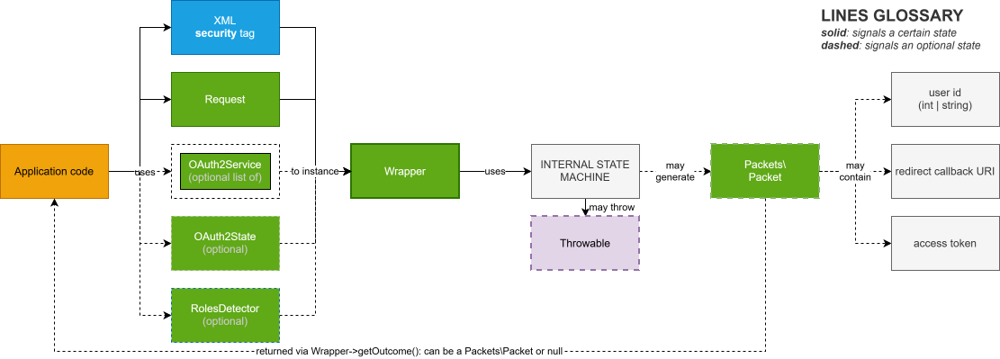
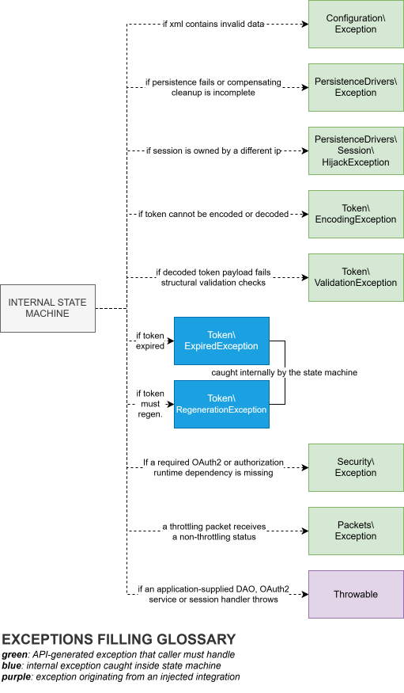

# Lucinda Web Security

Lucinda Web Security is a **web security state machine** for PHP applications. It restores the current identity, evaluates authentication, optional multi-factor authentication, and authorization, persists state transitions, and returns a typed outcome for the host application to handle.

Its goals are to:

- keep security decisions independent from controllers, templates, and HTTP response code;
- give form login, OAuth2, MFA, authorization, CSRF protection, persistence, and throttling one coherent workflow;
- expose expected outcomes as typed packets instead of exceptions;
- let the application own redirects, rendering, HTTP statuses, and bearer-token delivery;
- select application-specific DAOs and policies through XML while keeping the state machine itself opaque.

Install it with Composer:

```bash
composer require lucinda/security
```

It requires PHP 8.1 or newer, SimpleXML, and OpenSSL.

## Basic input and output



The application supplies:

- a complete XML document containing a `<security>` element;
- a normalized `Request`;
- OAuth2 services and an OAuth2 state store when OAuth2 is configured;
- a `RolesDetector` when XML route authorization is configured.

`Wrapper` runs the state machine during construction. Call `getOutcome()` once to obtain `Packets\Packet|null`:

```php
<?php

require __DIR__."/vendor/autoload.php";

use Lucinda\WebSecurity\Request;
use Lucinda\WebSecurity\Wrapper;

$xml = simplexml_load_file(__DIR__."/security.xml");
if (!$xml instanceof SimpleXMLElement) {
    throw new RuntimeException("Unable to load security configuration");
}

$request = new Request();
$request->setUri($applicationRoute);
$request->setContextPath($applicationContextPath);
$request->setIpAddress($clientIpAddress);
$request->setMethod($_SERVER["REQUEST_METHOD"] ?? "GET");
$request->setParameters($requestParameters);
$request->setAccessToken($bearerToken ?? "");

$wrapper = new Wrapper($xml, $request);
$outcome = $wrapper->getOutcome();
```

The library does not read routing information or credentials directly from application globals. The host application must normalize those values, resolve the client IP according to its trusted-proxy policy, and pass only the bearer-token value—not the `Bearer` scheme.

When optional integrations are needed, inject them explicitly:

```php
$wrapper = new Wrapper(
    xml: $xml,
    request: $request,
    oauth2Drivers: [
        "github" => $githubOAuth2Service,
    ],
    oauth2State: $oauth2State,
    rolesDetector: $rolesDetector
);
```

`null` means the state machine permits execution to continue as a guest. A packet must be handled according to its concrete type. Wrapper never sends a redirect or response itself.

See [basic I/O and Wrapper integration](docs/io.md) for request normalization, optional integrations, and a complete dispatch example.

## XML configuration


Pass the complete application document to `Wrapper`; it locates the required `<security>` child. Four sections are mandatory and MFA is optional:

```xml
<?xml version="1.0" encoding="UTF-8"?>
<application>
    <security>
        <persistence>
            <session
                parameter_name="lucinda_session"
                expiration="1800"
                is_http_only="1"
                is_https_only="1"
                same_site="Lax"
            />
        </persistence>

        <csrf secret="REPLACE_WITH_A_PRIVATE_SECRET" expiration="600" />

        <authentication>
            <form
                dao="App\Security\FormLoginDAO"
                throttler="App\Security\FormLoginThrottler"
                page="login"
                target_success="home"
                target_failure="login"
                target_throttled="login-throttled"
            />
            <logout
                dao="App\Security\LogoutDAO"
                page="logout"
                target_success="login"
                target_failure="logout-failed"
            />
        </authentication>

        <authorization>
            <by_dao
                page_dao="App\Security\PageAuthorizationDAO"
                user_dao="App\Security\UserAuthorizationDAO"
                logged_in_callback="forbidden"
                logged_out_callback="login"
            />
        </authorization>
    </security>
</application>
```

The principal structural rules are:

- Persistence is either `session`, `session` plus `remember_me`, or `synchronizer_token`.
- Authentication requires `form`, `oauth2`, or both, plus one `logout` definition.
- Authorization uses exactly one of `by_dao` and `by_route`.
- `multi_factor_authentication`, when present, requires a `totp` child.
- Class-name attributes select autoloadable implementations of the documented interfaces. Configuration detects them; deeper state-machine code constructs them without arguments.
- All durations are expressed in seconds. Cookie boolean values are `0` or `1`.

Never commit production secrets. XML values are used literally; the library does not expand environment-variable placeholders.

See the [complete XML configuration reference](docs/configuration.md) for every tag, attribute, default, allowed combination, and required interface.

## Packets


All returned objects inherit from `Packets\Packet`, which can expose a user ID, callback URI, library bearer token, and detailed failure reason. These values are optional, and a user ID by itself does not prove that authentication completed.

| Return value | Meaning |
| --- | --- |
| `null` | Continue the requested operation as a guest. |
| `Packets\GuestUser` | Render the form-login page using its guest CSRF token. |
| `Packets\LoggedInUser` | Authentication is complete; exposes the local user ID and an authenticated-user CSRF token. |
| `Packets\Security` | Authentication or authorization produced a caller-visible decision. |
| `Packets\MultiFactor` | MFA requires setup or a challenge, failed, or the pending stage expired. |
| `Packets\Throttling` | Form login or MFA is currently blocked by the configured throttler. |

Solid statuses in the diagram may be returned to the application. Dashed statuses are internal transitions: for example, `IDENTITY_VERIFIED` becomes either `LOGIN_OK` when MFA is absent or persisted `PENDING_MFA` state when MFA must run. Terminal internal success is represented publicly as `LoggedInUser`.

`Security` packets may also contain a `FailureReason`. In words, those reasons distinguish:

- malformed form input, rejected guest CSRF, and rejected credentials;
- malformed logout input, rejected authenticated-user CSRF, and a logout DAO rejection;
- invalid OAuth2 state, a provider error or rejected callback, an unlisted account, failed automatic registration, or rejected approval provisioning.

Failure reasons are suitable for diagnostics and response selection, but applications should avoid exposing account-sensitive detail or logging credentials and tokens.

See the [packet and status reference](docs/packets.md) for every numbered position in the diagram, the exact enum cases, type-specific fields, and failure reasons.

## Exceptions



Expected login rejection, authorization denial, MFA challenge, and throttling are packets—not exceptions. The green exception types represent invalid configuration, damaged or unsafe state, missing runtime dependencies, or failed framework operations that can escape to the caller:

| Exception | Meaning |
| --- | --- |
| `Configuration\Exception` | The security XML is missing required data, contains an invalid value or combination, or names a class with the wrong interface. |
| `PersistenceDrivers\Exception` | Authentication state could not be loaded, saved, cleared, or safely rolled back. |
| `PersistenceDrivers\Session\HijackException` | The current client IP differs from the IP recorded with the session. |
| `Token\EncodingException` | A token could not be encoded, decoded, encrypted, or authenticated cryptographically. |
| `Token\ValidationException` | A decoded token has invalid structure, types, IP binding, or authentication payload. |
| `Security\Exception` | A required OAuth2 or route-authorization dependency is missing, or authentication state is invalid. |
| `Packets\Exception` | A throttling packet was given a status that does not represent throttling. |

Exceptions can arise while constructing `Wrapper` and while building the public outcome through `getOutcome()`. Do not convert an unexpected exception into successful guest access.

See [exception handling](docs/exceptions.md) for the throw conditions and recommended boundary behavior for the green exceptions.

## Development

Install dependencies and run the test suite:

```bash
composer install
php test.php
```

From Windows, run PHP through WSL:

```powershell
wsl -d Ubuntu --cd /home/aherne/framework/security php test.php
```

## License

MIT.
