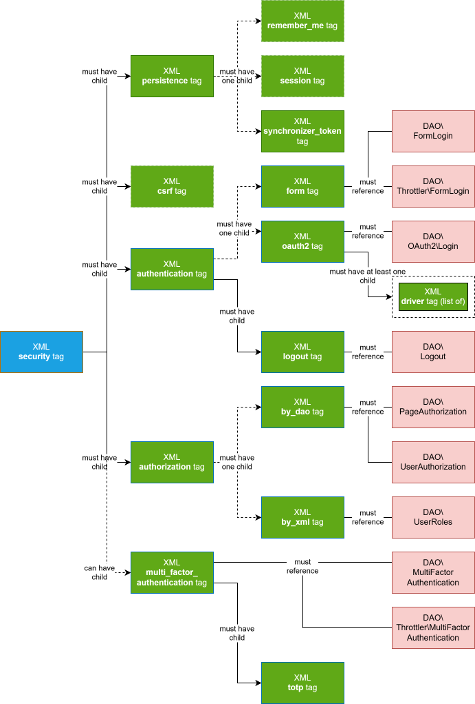

# XML configuration

[Back to the README](../README.md) · [Basic I/O](io.md)



Supply `Wrapper` with the complete XML document, not the `<security>` element alone. The document element can have any application-specific name, but it must contain one `<security>` child.

## Structure

```text
security
├── persistence
│   ├── session
│   ├── remember_me
│   └── synchronizer_token
├── csrf
├── authentication
│   ├── form
│   ├── oauth2
│   │   └── driver ...
│   └── logout
├── authorization
│   ├── by_dao
│   └── by_route
└── multi_factor_authentication
    └── totp
```

The structural rules are:

1. `persistence`, `csrf`, `authentication`, and `authorization` are required.
2. Persistence uses `session`, `session` plus `remember_me`, or `synchronizer_token`. `remember_me` cannot exist without `session`, and `synchronizer_token` cannot coexist with either cookie-based driver.
3. Authentication needs `form`, `oauth2`, or both. `logout` is always required as their sibling.
4. OAuth2 needs at least one `driver` child.
5. Authorization uses exactly one of `by_dao` and `by_route`.
6. `multi_factor_authentication` is optional, but requires `totp` when present.

The [session/form example](examples/security.xml) is a valid starting document.

## How implementation classes are resolved

XML attributes contain fully qualified, autoloadable class names. Configuration validates that each class implements the expected interface and stores the name. The state machine later constructs the class without constructor arguments.

| XML attribute | Required application interface |
| --- | --- |
| `form@dao` | `DAO\FormLogin` |
| `form@throttler` | `DAO\Throttler\FormLogin` |
| `logout@dao` | `DAO\Logout` |
| `oauth2@dao`, `existing_only` | `DAO\OAuth2\Login` |
| `oauth2@dao`, `automatic` | `DAO\OAuth2\AutomaticProvisioning` |
| `oauth2@dao`, `approval_required` | `DAO\OAuth2\ApprovalProvisioning` |
| `by_dao@page_dao` | `DAO\PageAuthorization` |
| `by_dao@user_dao` | `DAO\UserAuthorization` |
| `by_route@roles_dao` | `DAO\UserRoles` |
| `multi_factor_authentication@dao` | `DAO\MultiFactorAuthentication` |
| `multi_factor_authentication@throttler` | `DAO\Throttler\MultiFactorAuthentication` |

OAuth2 provider adapters, the OAuth2 state store, and the route-role detector are different: the host application constructs and injects those objects into `Wrapper`.

## Persistence

### Session

```xml
<persistence>
    <session
        parameter_name="lucinda_session"
        expiration="1800"
        is_http_only="1"
        is_https_only="1"
        same_site="Lax"
        handler="App\Session\Handler"
    />
</persistence>
```

| Attribute | Required | Default | Meaning |
| --- | --- | --- | --- |
| `parameter_name` | No | `uid` | Session key containing serialized authentication state. |
| `expiration` | No | `0` | Cookie lifetime and sliding session idle timeout in seconds; zero disables the driver's idle-expiry check. |
| `is_http_only` | No | `0` | Whether the session cookie receives `HttpOnly`. |
| `is_https_only` | No | `0` | Whether the session cookie receives `Secure`. |
| `same_site` | No | `Lax` | `None`, `Strict`, or `Lax`. |
| `handler` | No | PHP default | Class constructed and registered with `session_set_save_handler()`. |

The session driver binds its authentication data to the supplied client IP. Clearing authentication clears the entire active PHP session, including unrelated application entries.

### Session with remember-me

```xml
<persistence>
    <session
        parameter_name="lucinda_session"
        expiration="1800"
        is_http_only="1"
        is_https_only="1"
        same_site="Lax"
    />
    <remember_me
        parameter_name="lucinda_remember"
        secret="REPLACE_WITH_A_PRIVATE_REMEMBER_ME_SECRET"
        expiration="2592000"
        is_http_only="1"
        is_https_only="1"
        same_site="Lax"
    />
</persistence>
```

| Attribute | Required | Default | Meaning |
| --- | --- | --- | --- |
| `secret` | Yes | — | Secret used to protect the remember-me token. |
| `parameter_name` | No | `uid` | Remember-me cookie name. Use a name different from the session authentication key for clarity. |
| `expiration` | No | `86400` | Token and cookie lifetime in seconds. |
| `is_http_only` | No | `0` | Whether the cookie receives `HttpOnly`. |
| `is_https_only` | No | `0` | Whether the cookie receives `Secure`. |
| `same_site` | No | `Lax` | `None`, `Strict`, or `Lax`. |

The form login field selecting this behavior defaults to `remember_me`. Pending-MFA state is not written to remember-me persistence; the cookie is issued only after authentication completes.

### Synchronizer token

```xml
<persistence>
    <synchronizer_token
        secret="REPLACE_WITH_A_PRIVATE_BEARER_SECRET"
        expiration="3600"
        regeneration="300"
    />
</persistence>
```

| Attribute | Required | Default | Meaning |
| --- | --- | --- | --- |
| `secret` | Yes | — | Secret used for authenticated token encryption. |
| `expiration` | No | `3600` | Token lifetime in seconds. |
| `regeneration` | No | `60` | Token age at which a live token is renewed. |

The application extracts the incoming bearer value into `Request::setAccessToken()` and delivers any replacement returned through `Packet::getAccessToken()`.

## CSRF

```xml
<csrf secret="REPLACE_WITH_A_PRIVATE_CSRF_SECRET" expiration="600" />
```

| Attribute | Required | Default | Meaning |
| --- | --- | --- | --- |
| `secret` | Yes | — | Secret used to protect CSRF tokens. |
| `expiration` | No | `600` | Token lifetime in seconds. |

Use a private value distinct from persistence secrets. `GuestUser` supplies the login-form token; `LoggedInUser` supplies a token bound to the authenticated local user.

## Authentication

`authentication` accepts form login, OAuth2, or both. A logout definition is mandatory in every case.

### Form login

```xml
<form
    dao="App\Security\FormLoginDAO"
    throttler="App\Security\FormLoginThrottler"
    page="login"
    target_success="home"
    target_failure="login"
    target_throttled="login-throttled"
    parameter_username="username"
    parameter_password="password"
    parameter_remember_me="remember_me"
    csrf="csrf"
/>
```

| Attribute | Required | Default | Meaning |
| --- | --- | --- | --- |
| `dao` | Yes | — | `DAO\FormLogin` implementation. |
| `throttler` | Yes | — | `DAO\Throttler\FormLogin` implementation. |
| `page` | Yes | — | Application-relative login route. |
| `target_success` | Yes | — | Callback when form login completes without MFA taking over, or login is already satisfied. |
| `target_failure` | Yes | — | Callback after rejected login input or credentials. |
| `target_throttled` | Yes | — | Callback when the throttler blocks login. |
| `parameter_username` | No | `username` | Username request field. |
| `parameter_password` | No | `password` | Password request field. |
| `parameter_remember_me` | No | `remember_me` | Remember-me request field. |
| `csrf` | No | `csrf` | Guest CSRF request field. |

Failed credentials are penalized by the throttler. The throttler owns thresholds, counters, decay, and blocking duration through its persistence implementation.

### OAuth2

```xml
<oauth2
    dao="App\Security\OAuth2LoginDAO"
    provisioning="existing_only"
    state_expiration="600"
    target_success="home"
    target_failure="login"
>
    <driver name="github" login="oauth/github" />
    <driver name="google" login="oauth/google" />
</oauth2>
```

| Attribute | Required | Meaning |
| --- | --- | --- |
| `dao` | Yes | Account lookup/provisioning implementation selected by `provisioning`. |
| `provisioning` | Yes | `existing_only`, `automatic`, or `approval_required`. |
| `state_expiration` | Yes | OAuth2 state lifetime in seconds. |
| `target_success` | Yes | Callback when OAuth2 login completes without MFA taking over, or login is already satisfied. |
| `target_failure` | Yes | Callback after state, provider, account, or provisioning rejection. |
| `target_pending` | Only for `approval_required` | Callback while local account approval is pending. |

Each `driver` requires:

| Attribute | Meaning |
| --- | --- |
| `name` | Key used to locate the injected `OAuth2Service`. |
| `login` | Application-relative route used to initiate login and receive its callback. |

`existing_only` accepts only identities already mapped by `resolve()`. `automatic` may call `create()` when no account exists. `approval_required` may call `requestApproval()` and return `LOGIN_PENDING`.

### Logout

```xml
<logout
    dao="App\Security\LogoutDAO"
    page="logout"
    target_success="login"
    target_failure="logout-failed"
    csrf="csrf"
/>
```

| Attribute | Required | Default | Meaning |
| --- | --- | --- | --- |
| `dao` | Yes | — | `DAO\Logout` implementation. |
| `page` | Yes | — | Application-relative logout route. |
| `target_success` | Yes | — | Callback after DAO acceptance and persistence cleanup. |
| `target_failure` | Yes | — | Callback after request, CSRF, or DAO rejection. |
| `csrf` | No | `csrf` | Authenticated-user CSRF request field. |

Logout is accepted only as a valid POST operation for an authenticated user.

## Authorization

### Page and user DAOs

```xml
<authorization>
    <by_dao
        page_dao="App\Security\PageAuthorizationDAO"
        user_dao="App\Security\UserAuthorizationDAO"
        logged_in_callback="forbidden"
        logged_out_callback="login"
    />
</authorization>
```

| Attribute | Meaning |
| --- | --- |
| `page_dao` | Resolves the request URI to a page ID and reports whether it is public. |
| `user_dao` | Checks the authenticated user's permission for a non-public page and HTTP method. |
| `logged_in_callback` | Destination for a denied authenticated user or missing resource. |
| `logged_out_callback` | Destination for a denied guest or missing resource. |

Public pages allow guest access without calling the user-specific permission check.

### Route roles

```xml
<authorization>
    <by_route
        roles_dao="App\Security\UserRolesDAO"
        logged_in_callback="forbidden"
        logged_out_callback="login"
    />
</authorization>
```

| Attribute | Meaning |
| --- | --- |
| `roles_dao` | Returns roles for the current user or guest. |
| `logged_in_callback` | Destination when an authenticated user lacks a matching role. |
| `logged_out_callback` | Destination when a guest lacks a matching role. |

The host application must also inject a `RolesDetector` containing roles indexed by route. A route is allowed when at least one application-supplied user/guest role matches one configured route role.

## Multi-factor authentication

```xml
<multi_factor_authentication
    dao="App\Security\MultiFactorAuthenticationDAO"
    throttler="App\Security\MultiFactorAuthenticationThrottler"
    expiration="28800"
    pending_expiration="300"
    challenge_route="mfa/challenge"
    setup_route="mfa/setup"
    success_route="home"
    failure_route="mfa/challenge"
    throttled_route="mfa/throttled"
    expired_route="login"
>
    <totp
        issuer="Example Application"
        code_param="code"
        period="30"
        digits="6"
        window="1"
    />
</multi_factor_authentication>
```

Every attribute on `multi_factor_authentication` is required:

| Attribute | Meaning |
| --- | --- |
| `dao` | MFA policy, enrollment-secret storage, enrolled-secret lookup, and atomic TOTP replay protection. |
| `throttler` | Failed MFA attempt persistence and blocking policy. |
| `expiration` | Seconds for which successful MFA remains fresh. Once stale, MFA is evaluated again. |
| `pending_expiration` | Seconds allowed to complete MFA after primary identity verification. |
| `challenge_route` | Destination when an enrolled factor must be verified. |
| `setup_route` | Destination when enrollment is required. |
| `success_route` | Destination after successful verification or an MFA `NOT_REQUIRED` decision. |
| `failure_route` | Destination after rejected code verification. |
| `throttled_route` | Destination when the MFA throttler blocks an attempt. |
| `expired_route` | Destination when pending MFA expires and authentication must restart. |

The `totp` child has these settings:

| Attribute | Required | Default | Meaning |
| --- | --- | --- | --- |
| `issuer` | Yes | — | Issuer label embedded in the authenticator provisioning URI. |
| `code_param` | No | `code` | Submitted TOTP request field. |
| `period` | No | `30` | TOTP time-step duration in seconds. |
| `digits` | No | `6` | Code length; allowed values are `6`, `7`, and `8`. |
| `window` | No | `1` | Accepted time steps before and after the current step; zero accepts only the current step. |

The MFA DAO must atomically consume verified TOTP counters so the same code cannot succeed twice, including during enrollment confirmation.

## Configuration hygiene

- Keep CSRF, remember-me, and bearer-token secrets private and separate.
- Values are literal; XML does not expand `${ENVIRONMENT_VARIABLE}` syntax.
- Use `is_https_only="1"` for HTTPS cookie deployments and choose `SameSite` according to the application's cross-site requirements.
- Keep route normalization identical between the router, `Request::setUri()`, and configured routes.
- Ensure every selected class is available through Composer autoloading and has a constructor that needs no arguments.
- Treat every duration as seconds and every cookie boolean as exactly `0` or `1`.
