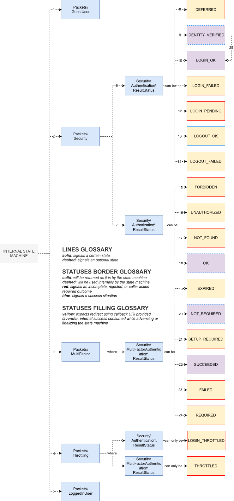

# Packets and statuses

[Back to the README](../README.md) · [Basic I/O](io.md)

`Wrapper::getOutcome()` returns `Packets\Packet|null`. A packet is a state-machine decision or an authenticated identity representation; it is not an HTTP response. The host application decides how to render it, which HTTP status to use, and whether to follow its callback.

## Shared packet fields

Every concrete packet inherits these optional values from `Packets\Packet`:

| Getter | Meaning |
| --- | --- |
| `getUserID()` | Associated local identity. It does not by itself prove completed authentication. |
| `getCallback()` | Local path or external URL for caller-owned navigation. Reading it does not redirect. |
| `getAccessToken()` | Library authentication bearer token, never an OAuth2 provider token. |
| `getFailureReason()` | Detailed authentication rejection reason, when one was attached. |

Handle the concrete packet type before reading type-specific fields. Result enums from different concerns have overlapping integer backing values; compare enum cases rather than integers.

## Numbered diagram reference

### Packet types

| Index | Element | Public meaning |
| ---: | --- | --- |
| 1 | `Packets\GuestUser` | The current route is the form-login page for a guest. `getCsrfToken()` supplies the token to place in the login form. |
| 2 | `Packets\Security` | Carries an authentication or authorization `ResultStatus`, a callback, and sometimes a `FailureReason`. |
| 3 | `Packets\MultiFactor` | Carries an MFA `ResultStatus`; setup can also expose a secret and provisioning URI. |
| 4 | `Packets\Throttling` | Carries only form `LOGIN_THROTTLED` or MFA `THROTTLED`, plus the relevant callback and identity when available. |
| 5 | `Packets\LoggedInUser` | Represents completed authentication. Exposes the local user ID and an authenticated-user CSRF token. |

`null` is intentionally not a packet: it means authorization allowed the request to continue as a guest.

### Status families

| Index | Element | Meaning |
| ---: | --- | --- |
| 6 | `Security\Authentication\ResultStatus` | Login, OAuth2, and logout workflow decisions carried by `Packets\Security`, except throttling. |
| 7 | `Security\Authorization\ResultStatus` | Per-request resource-access decisions carried by `Packets\Security`. |

### Authentication statuses

| Index | Status | Visibility | Meaning |
| ---: | --- | --- | --- |
| 8 | `DEFERRED` | Returned | Continue through its callback—for example, to an OAuth2 provider or away from a login/logout operation already satisfied by current state. |
| 9 | `IDENTITY_VERIFIED` | Internal | Primary credentials or an OAuth2 identity resolved to a local user. MFA and persistence still need to be decided. |
| 10 | `LOGIN_OK` | Internal | Login completed without an outstanding MFA stage. Public outcome building normally replaces it with `LoggedInUser`. |
| 11 | `LOGIN_FAILED` | Returned | Form or OAuth2 login was rejected. A `FailureReason` identifies the category. |
| 12 | `LOGIN_PENDING` | Returned | OAuth2 provisioning requires approval and no completed local identity exists yet. This is unrelated to `PENDING_MFA`. |
| 13 | `LOGOUT_OK` | Returned | The logout DAO accepted the operation and Wrapper cleared authentication persistence before returning the packet. |
| 14 | `LOGOUT_FAILED` | Returned | Logout request validation, CSRF validation, or the logout DAO rejected the operation. |

`LOGIN_THROTTLED` belongs to the same authentication enum but is carried by `Packets\Throttling`, not `Packets\Security`.

### Authorization statuses

| Index | Status | Visibility | Meaning |
| ---: | --- | --- | --- |
| 15 | `FORBIDDEN` | Returned | An authenticated user is not allowed to access the requested resource. |
| 16 | `UNAUTHORIZED` | Returned | A guest does not satisfy the resource's access policy. |
| 17 | `NOT_FOUND` | Returned | No page or applicable route-role policy was found. The callback depends on whether the request was authenticated. |
| 18 | `OK` | Internal | Access is allowed. Public outcome building subsequently returns `LoggedInUser` for an authenticated identity or `null` for a guest. |

These are state-machine results, not prescribed HTTP status codes.

### MFA statuses

| Index | Status | Visibility | Meaning |
| ---: | --- | --- | --- |
| 19 | `EXPIRED` | Returned | The pending-MFA deadline is absent or reached. Wrapper clears authentication state and persistence. |
| 20 | `NOT_REQUIRED` | Internal | Application policy does not currently require MFA. A pending identity is promoted without an MFA freshness deadline; an authenticated identity continues to authorization. |
| 21 | `SETUP_REQUIRED` | Returned | The user must enroll TOTP. The packet can contain the sensitive setup secret and provisioning URI. |
| 22 | `SUCCEEDED` | Internal | The submitted code and counter were accepted. Wrapper persists authenticated state with a new MFA freshness deadline and public outcome building returns `LoggedInUser`. |
| 23 | `FAILED` | Returned | The code did not verify or its TOTP counter could not be atomically consumed. |
| 24 | `REQUIRED` | Returned | An enrolled factor must be verified before authentication can continue. |

`THROTTLED` belongs to the MFA enum but is carried by `Packets\Throttling`.

### Authentication transition

| Index | Transition | Meaning |
| ---: | --- | --- |
| 25 | `IDENTITY_VERIFIED → LOGIN_OK` | Occurs only when MFA is not configured. If MFA is configured, Wrapper instead persists `AuthenticationStage::PENDING_MFA`, discards the identity-verification packet, and immediately evaluates MFA. |

`PENDING_MFA` is persisted authentication state, not a packet status. It lasts only until `pending_expiration`; successful MFA changes it to `AUTHENTICATED`, while `EXPIRED` clears it.

## Failure reasons

`Packets\Security::getFailureReason()` may return `Security\FailureReason`. The reason refines `LOGIN_FAILED` or `LOGOUT_FAILED`; it does not replace the broad status.

### Form login

| Reason | Meaning |
| --- | --- |
| `FORM_PARAMETERS_INVALID` | A required field is absent, empty under PHP's `empty()` rules, or not a string. |
| `FORM_CSRF_REJECTED` | The submitted token is invalid for the guest login context. |
| `FORM_CREDENTIALS_REJECTED` | The login DAO did not return an accepted local user ID. |

### Logout

| Reason | Meaning |
| --- | --- |
| `LOGOUT_PARAMETERS_INVALID` | The request is not POST or its CSRF field is missing, empty, or not a string. |
| `LOGOUT_CSRF_REJECTED` | The submitted token is invalid for the authenticated user. |
| `LOGOUT_REJECTED` | The logout DAO declined the operation. |

### OAuth2

| Reason | Meaning |
| --- | --- |
| `OAUTH_INVALID_STATE` | State is missing, malformed, unknown, expired, already consumed, or bound to another provider. |
| `OAUTH_ERROR` | The provider callback contains an error after state was accepted. |
| `OAUTH_PROVIDER_REJECTED` | The accepted-state callback lacks a non-empty authorization code. |
| `OAUTH_ACCOUNT_UNLISTED` | No existing local account was found and provisioning is `existing_only`. |
| `OAUTH_REGISTRATION_REJECTED` | Automatic provisioning did not create a local account. |
| `OAUTH_ACCOUNT_REJECTED` | Approval provisioning rejected the account request. |

Use failure reasons for diagnostics and response selection, but expose suitably generic messages to end users. Never log passwords, CSRF tokens, OAuth2 state, bearer tokens, submitted MFA codes, enrollment secrets, or provisioning URIs.

## Packet-specific data

| Packet | Additional getters |
| --- | --- |
| `GuestUser` | `getCsrfToken()` for the login form. |
| `LoggedInUser` | `getCsrfToken()` for authenticated-user form protection. |
| `Security` | `getStatus()` returning an authentication or authorization enum. |
| `MultiFactor` | `getStatus()`, `getSecret()`, `getProvisioningURI()`, and `getValidUntil()`. |
| `Throttling` | `getStatus()` returning form `LOGIN_THROTTLED` or MFA `THROTTLED`. |

`MultiFactor::getValidUntil()` is the freshness deadline assigned to successful MFA; it is not the pending-MFA completion deadline and is normally consumed into persisted authentication state before the public packet is returned.

## Callbacks and bearer-token delivery

Local callbacks are prefixed with `Request::getContextPath()`. OAuth2 initiation can instead return an absolute provider authorization URL. A callback describes a destination; Wrapper does not redirect.

With synchronizer-token persistence, public outcome building attaches the current or replacement authentication token to the packet. Deliver it even when the packet represents a challenge or failure. After successful bearer logout, remove the token stored by the client; no empty replacement token is emitted.

A `LoggedInUser` packet proves authentication completion, not universal resource permission. Authorization remains request-specific, and a login or MFA completion packet can end its request before the callback destination itself is authorized.
